# PokeMemories · Salón de la Fama y Álbum de Recuerdos Pokémon


## Mi proyecto

**PokeMemories** es una aplicación web pensada para entrenadores y aficionados a Pokémon que quieren inmortalizar, registrar y rememorar sus partidas y desafíos completados (ediciones como *HeartGold*, *Esmeralda*, *Platino*, *Rojo Fuego*, etc.).

La aplicación permite registrar cada aventura en el navegador vinculando las horas de juego, la fecha de victoria en la Liga, la licencia oficial de entrenador y el equipo titular de 1 a 6 Pokémon (con sus motes, niveles y ataques insignia). Además, rinde homenaje especial a las **«Leyendas Caídas»**: aquellos Pokémon que no llegaron a la cima de la Liga porque cayeron en batallas épicas a lo largo del camino, pero cuya hazaña merece un lugar de honor en el recuerdo de la partida.

**Web publicada:** <!-- https://<proyecto>.vercel.app -->

### La entidad

| Campo | Control | Obligatorio | Regla de validación | Mensaje si no se cumple |
|-------|---------|:-----------:|---------------------|-------------------------|
| **Código de registro** | Texto con prefijo automático (`POKE-XXX-`) | Sí | Prefijo y siglas automáticos según la edición + 1 a 4 dígitos (`^\d{1,4}$`), normalizado a `^POKE-[A-Z]{3}-\d{4}$` | Introduce solo entre 1 y 4 dígitos (ej. 001 o 0042) |
| **Título de la partida** | Texto | Sí | Longitud entre 3 y 40 caracteres | El título debe tener entre 3 y 40 caracteres |
| **Edición del juego** | Selector visual de carátulas (`radio`) | Sí | Coincidir con una de las 24 ediciones oficiales (hasta *Leyendas: Z-A*) | Selecciona una edición oficial de la lista |
| **Fecha de victoria** | Fecha | Sí | No puede ser posterior a la fecha actual (`max` dinámico) | La fecha de victoria no puede estar en el futuro |
| **Tiempo de juego** | Texto | Sí | Expresión regular `^\d{1,3}:[0-5]\d$` | Introduce el tiempo en formato Horas:Minutos (ej. 45:30) |
| **ID de Entrenador** | Texto | Sí | Regex `^\d{5}-\d$` + cálculo del dígito de control (suma de los 5 dígitos módulo 10) | El dígito de control del ID de Entrenador no es correcto |
| **Modalidad de partida** | Botones de opción (`radio`) | Sí | Mutuamente excluyente: `Clásica` o `Locke` | Selecciona si la partida es Clásica o Locke |
| **Modalidades Locke** *(Condicional)* | Casillas (`checkbox`, varias a la vez) | Sí (si es `Locke`) | Al menos una entre `Nuzlocke`, `Randomlocke`, `Vidalocke`, `Hardlocke` (`hidden` y `disabled` en `Clásica`) | Selecciona al menos una modalidad de Locke |
| **¿Hubo leyendas caídas?** | Casilla | No | Booleano | - |
| **Leyendas Caídas** *(Sección condicional, 1 a 6)* | Plantilla `<template>` (`hidden` y `disabled` si no se marca) | Sí (si la casilla está activa) | De 1 a 6 Pokémon caídos: mote (2-20), nivel al caer (1-100) y hazaña/recuerdo (10-120 caracteres) | Explica la hazaña de tu héroe caído (entre 10 y 120 caracteres) |
| **Equipo Campeón** *(Grupo dinámico)* | Plantilla `<template>` (1 a 6) | Sí | Entre 1 y 6 miembros. Mote (2-20 caracteres), nivel (1-100) y movimiento clave (2-30 caracteres) | Debes registrar entre 1 y 6 Pokémon en el equipo |

### El registro de usuarios

| Campo | Control | Regla | Mensaje |
|-------|---------|-------|---------|
| **Nombre de usuario** | Texto | Expresión regular `^[a-zA-Z0-9_]{3,15}$` y no estar ya ocupado | El nombre debe tener entre 3 y 15 letras, números o guiones bajos y estar libre |
| **Correo electrónico** | Email | Formato de correo electrónico válido (`type="email"`) | Introduce una dirección de correo electrónico válida |
| **Contraseña** | Contraseña | Mínimo 8 caracteres, al menos una mayúscula (`\p{Lu}`), una minúscula (`\p{Ll}`) y un dígito (`\d`) | Debe tener al menos 8 caracteres, con mayúscula, minúscula y número |
| **Repetir contraseña** | Contraseña | Coincidir exactamente con el campo de contraseña | Las contraseñas no coinciden |
| **Aceptación de condiciones** | Casilla | Casilla obligatoria marcada (`required`) | Debes aceptar las condiciones de uso de PokeMemories |

### Páginas

| Página | Acceso | Qué hace |
|--------|--------|----------|
| `index.html` | Pública | Inicio de sesión de entrenadores con control de doble envío y redirección al listado si ya hay sesión activa |
| `registro.html` | Pública | Registro de nuevos entrenadores con validación en tiempo real de contraseña y sus requisitos visuales |
| `listado.html` | Privada (Usuarios) | Vitrina de recuerdos de partidas con buscador sin tildes/mayúsculas (debounce), paginación y borrado con confirmación en `<dialog>` |
| `ficha.html` | Privada (Usuarios) | Formulario de alta y edición de partidas con selector visual de carátulas, campo condicional (leyendas caídas) y equipo de 1 a 6 Pokémon |
| `usuarios.html` | Privada (Solo Administradores) | Panel de administración de entrenadores con buscador, paginación y asignación o retirada de permisos de administrador |

## Arquitectura y módulos

### Diagrama de módulos

```mermaid
graph TD
  subgraph Vistas ["Páginas (Controladores)"]
    login["js/paginas/login.js"]
    registro["js/paginas/registro.js"]
    listado["js/paginas/listado.js"]
    ficha["js/paginas/ficha.js"]
    usuarios["js/paginas/usuarios.js"]
  end

  subgraph Componentes ["Componentes Reutilizables"]
    cabecera["js/componentes/cabecera.js"]
    claveVis["js/componentes/claveVisible.js"]
    valForm["js/componentes/validacionFormulario.js"]
    pagComp["js/componentes/paginacion.js"]
  end

  subgraph Datos ["Lógica y Almacenamiento"]
    modUsuarios["js/datos/usuarios.js"]
    modSesion["js/datos/sesion.js"]
    modPartidas["js/datos/partidas.js"]
    modEdiciones["js/datos/ediciones.js"]
  end

  subgraph Utilidades ["Utilidades Puras"]
    validadores["js/validadores.js"]
    paginacion["js/paginacion.js"]
    avisos["js/avisos.js"]
    clave["js/clave.js"]
  end

  login --> cabecera
  login --> avisos
  login --> claveVis
  login --> valForm
  login --> modSesion
  login --> modUsuarios
  login --> clave

  registro --> cabecera
  registro --> avisos
  registro --> claveVis
  registro --> valForm
  registro --> modSesion
  registro --> modUsuarios
  registro --> clave

  listado --> cabecera
  listado --> avisos
  listado --> pagComp
  listado --> modSesion
  listado --> modPartidas
  listado --> modEdiciones
  listado --> paginacion

  ficha --> cabecera
  ficha --> avisos
  ficha --> valForm
  ficha --> modSesion
  ficha --> modPartidas
  ficha --> modEdiciones
  ficha --> validadores

  usuarios --> cabecera
  usuarios --> avisos
  usuarios --> pagComp
  usuarios --> modSesion
  usuarios --> modUsuarios
  usuarios --> paginacion

  valForm --> validadores
  cabecera --> modSesion
  cabecera --> avisos
```



### Tabla de módulos

| Módulo | Responsabilidad | ¿Usa el DOM? | Exportaciones principales |
|--------|-----------------|:------------:|---------------------------|
| `js/validadores.js` | Funciones puras de validación de datos de usuario y partidas de Pokémon | No | `validarNombreUsuario`, `validarClave`, `validarCodigoRegistro`, `validarIdEntrenador`, `validarEdicion`, `validarTiempoJuego`, `validarEquipoPokemon`, etc. |
| `js/paginacion.js` | Lógica matemática pura de paginación y filtrado multi-palabra insensible a tildes | No | `paginar`, `normalizarTextoBusqueda`, `filtrarLista` |
| `js/clave.js` | Cálculo asíncrono del resumen criptográfico SHA-256 de contraseñas | No | `resumirClave` |
| `js/avisos.js` | Sistema desacoplado de avisos basado en eventos personalizados del DOM | Sí | `lanzarAviso`, `inicializarAvisos`, `guardarAvisoPendiente`, `consumirAvisoPendiente` |
| `js/datos/usuarios.js` | CRUD tolerante a fallos de usuarios en almacenamiento web | No (usa Storage) | `obtenerUsuarios`, `guardarUsuarios`, `buscarUsuario`, `registrarUsuario`, `verificarCredenciales`, `cambiarRolUsuario` |
| `js/datos/sesion.js` | Gestión de sesión activa de entrenador en sessionStorage | No (usa Storage) | `obtenerSesion`, `guardarSesion`, `cerrarSesion`, `haySesionActiva` |
| `js/datos/partidas.js` | CRUD tolerante a fallos de recuerdos de partidas por usuario | No (usa Storage) | `obtenerPartidas`, `guardarPartidas`, `crearPartida`, `buscarPartidaPorId`, `actualizarPartida`, `borrarPartida` |
| `js/datos/ediciones.js` | Catálogo de 24 ediciones Pokémon, rutas de carátulas, siglas y temas de color | No | `EDICIONES_OFICIALES`, `obtenerCaratulaEdicion`, `obtenerSiglasEdicion`, `obtenerTemaEdicion` |
| `js/componentes/cabecera.js` | Renderizado accesible de barra de navegación y control de acceso privado | Sí | `protegerPagina`, `renderizarCabecera` |
| `js/componentes/claveVisible.js` | Conmutador accesible de visibilidad de contraseñas (botón de ojo con SVG y ARIA) | Sí | `vincularAlternadorClave` |
| `js/componentes/validacionFormulario.js` | Motor de validación en tiempo real en fase de captura con atributos ARIA | Sí | `configurarValidacionFormulario` |
| `js/componentes/paginacion.js` | Controles de paginación con Bootstrap y sincronización bidireccional con la URL | Sí | `leerPaginaDeUrl`, `actualizarPaginaEnUrl`, `renderizarPaginacion`, `vincularPaginacion` |
| `js/paginas/login.js` | Controlador de inicio de sesión (`index.html`) | Sí | `iniciarLogin` |
| `js/paginas/registro.js` | Controlador de registro de usuarios (`registro.html`) | Sí | `iniciarRegistro` |
| `js/paginas/listado.js` | Controlador de la vitrina de recuerdos y diálogo de borrado (`listado.html`) | Sí | `iniciarListado` |
| `js/paginas/ficha.js` | Controlador de alta y edición de partidas con carátulas y grupos dinámicos (`ficha.html`) | Sí | `iniciarFicha` |
| `js/paginas/usuarios.js` | Controlador de administración de entrenadores y gestión de roles (`usuarios.html`) | Sí | `iniciarUsuarios` |

### Patrones de diseño aplicados

1. **Patrón Estrategia (Strategy):**
   - Implementado en el motor de validación `js/componentes/validacionFormulario.js` y el mapa `validadores` de `js/validadores.js`.
   - Cada campo declara en su atributo HTML `data-validar="nombreRegla"` la estrategia concreta que debe evaluarlo. El validador busca la función correspondiente en el diccionario sin necesidad de estructuras `switch` o `if/else` anidadas, permitiendo además inyectar `reglasExtra` personalizadas (como la validación de fecha dependiente de un reloj inyectado).
2. **Patrón Factoría / Estado (Factory & State):**
   - En `js/datos/partidas.js` y `js/datos/usuarios.js`, la creación de entidades normaliza las propiedades asegurando valores por defecto robustos ante estructuras incompletas o corruptas (UUID v4 nativo o determinista, arrays vacíos si no hay caídos, booleano normalizado).
   - En la interfaz de usuario, las funciones `crearTarjetaPartida` y `crearFilaUsuario` actúan como factorías DOM: clonan plantillas `<template>`, rellenan su contenido de forma segura con `textContent` y configuran atributos de accesibilidad según el estado de la entidad.
3. **Inyección de Dependencias (Dependency Injection):**
   - Todos los módulos de datos y controladores reciben sus dependencias de entorno (`almacenUsuarios`, `almacenPartidas`, `almacenSesion`, `doc`, `localizacion`, `historial`, `fechaReferencia`) como parámetros opcionales con valores predeterminados globales (`localStorage`, `sessionStorage`, `document`, `window.location`).
   - Esto permite que en las pruebas de integración en happy-dom se puedan inyectar instancias de `AlmacenFalso` y espías de Vitest (`vi.fn()`), aislando por completo cada test sin ensuciar el estado del navegador ni depender de APIs de red.

### Documentación JSDoc

Todo el código fuente está documentado con anotaciones JSDoc descriptivas:
- Identificación de módulos con `@module`.
- Parámetros tipados con `@param {tipo} nombre - descripción`.
- Valores devueltos con `@returns {tipo}`.
- Eventos personalizados documentados con `@fires CustomEvent#aviso` y `@listens`.
- Definición de tipos de datos complejos con `@typedef {Object}`.
- Ejemplos de uso en funciones puras con `@example`.

La documentación completa en formato HTML estático se genera ejecutando:
```bash
npm run docs
```
Los ficheros resultantes se guardan en el directorio `docs/`.

## Cómo ejecutarlo

### Requisitos previos
- Node.js 24 (o superior) y npm.
- Opcionalmente Docker y VS Code con la extensión *Dev Containers*.

### Pasos de ejecución local

1. **Entorno en Dev Container (recomendado):**
   - Abrir la carpeta del proyecto en VS Code.
   - Pulsar `F1` y seleccionar **Dev Containers: Reopen in Container**.
   - El contenedor configura automáticamente Node.js 24, Chromium para Playwright y todas las extensiones de trabajo.

2. **Servir la aplicación web localmente:**
   - La aplicación corre sobre el puerto `3901`:
     ```bash
     npx --yes serve@14.2.6 --no-clipboard --listen 3901 .
     ```
   - Abrir en el navegador: [http://localhost:3901](http://localhost:3901)

3. **Ejecutar las comprobaciones y pruebas:**
   - Pruebas unitarias y de integración:
     ```bash
     npm test
     ```
   - Medición de cobertura con comprobación del umbral del 90 %:
     ```bash
     npm run coverage
     ```
   - Pruebas de extremo a extremo con Playwright:
     ```bash
     npm run e2e
     ```
   - Comprobación de reglas de código con ESLint:
     ```bash
     npm run lint
     ```
   - Comprobación de formato con Prettier:
     ```bash
     npm run format:check
     ```
   - Aplicar formato automático:
     ```bash
     npm run format
     ```
   - Generar la documentación JSDoc:
     ```bash
     npm run docs
     ```
   - Empaquetar la aplicación publicable en `dist/`:
     ```bash
     npm run build
     ```

## Almacenamiento y sesión

### Claves utilizadas

| Clave | Almacenamiento | Qué guarda | Ejemplo de contenido |
|-------|----------------|------------|----------------------|
| `PokeMemories_usuarios` | `localStorage` | Lista de entrenadores registrados con contraseñas resumidas y rol | `[{"nombreUsuario":"AshKetchum","email":"ash@kanto.org","resumenClave":"a665a45920...","rol":"administrador","fechaRegistro":"2026-11-19T10:00:00.000Z"}]` |
| `PokeMemories_sesion` | `sessionStorage` | Datos del entrenador con sesión activa actualmente en la pestaña | `{"nombreUsuario":"AshKetchum","rol":"administrador"}` |
| `PokeMemories_partidas_<usuario>` | `localStorage` | Colección de recuerdos de partidas asociadas a un entrenador concreto | `[{"id":"a1b2c3d4-...","codigoRegistro":"POKE-HGD-0042","titulo":"Oro HeartGold en mi 3ds","edicion":"HeartGold","fechaVictoria":"2026-10-15","tiempoJuego":"45:30","idEntrenador":"00151-7","tipoPartida":"Clásica","modalidadesLocke":[],"huboLeyendasCaidas":false,"leyendasCaidas":[],"equipo":[{"mote":"Typhlosion","nivel":65,"movimientoClave":"Lanzallamas"}]}]` |
| `PokeMemories_aviso_pendiente` | `sessionStorage` | Mensaje flash informativo o de éxito pendiente de ser mostrado tras redirigir | `{"mensaje":"Recuerdo guardado en tu vitrina","tipo":"success"}` |

### Justificación de cada ubicación

- **`localStorage` (persistente):** Se usa para la colección de usuarios (`PokeMemories_usuarios`) y los recuerdos de cada entrenador (`PokeMemories_partidas_<usuario>`). Estas entidades representan información permanente del usuario que debe persistir entre sesiones, reinicios del navegador y diferentes pestañas.
- **`sessionStorage` (volátil):** Se utiliza para la sesión activa (`PokeMemories_sesion`) y los avisos pendientes entre páginas (`PokeMemories_aviso_pendiente`). La sesión solo debe permanecer mientras la pestaña o ventana del navegador esté abierta; al cerrarla, la sesión expira automáticamente garantizando privacidad. Los avisos pendientes se consumen y eliminan inmediatamente en la página de destino para evitar repeticiones.

### Control de roles y protección de páginas

- La función `protegerPagina` (en `js/componentes/cabecera.js`) se ejecuta al arrancar cada página privada (`listado.html`, `ficha.html`, `usuarios.html`):
  1. Si no hay sesión válida en `sessionStorage`, almacena un aviso pendiente y redirige inmediatamente a `index.html`.
  2. En páginas restringidas (`soloAdmin: true`, como `usuarios.html`), comprueba además si `sesion.rol === 'administrador'`. Si no lo es, emite un aviso de acceso denegado y redirige a `listado.html`.
- En la interfaz, la cabecera oculta el enlace a `👥 Usuarios` si el entrenador no es administrador.
- En la zona de administración, el administrador conectado tiene deshabilitado el botón de retirarse a sí mismo los privilegios de administrador (`disabled="true"` con `title` y `aria-describedby`), evitando que el sistema quede sin administradores por accidente.

### Por qué este sistema de sesión en cliente no es seguro

En una aplicación web puramente del lado del cliente (sin backend):
- **Cualquier usuario puede abrir las DevTools** (`F12`), acceder a la pestaña **Application -> Session Storage**, editar el valor de `PokeMemories_sesion` y cambiar su rol de `"usuario"` a `"administrador"`. Al recargar, el código en JavaScript leerá ese nuevo valor y le concederá acceso a `usuarios.html`.
- Del mismo modo, el usuario puede manipular o borrar datos ajenos modificando las claves de `localStorage`.
- **Cómo se implementa en una aplicación real:** La autenticación se delega en un servidor seguro con base de datos. La sesión se gestiona mediante cookies firmadas con atributos `HttpOnly`, `Secure` y `SameSite=Strict`, o mediante tokens criptográficos (JWT) validados en cada petición por una API en el servidor. El cliente jamás decide qué permisos tiene: cualquier intento de alterar la interfaz es rechazado por el servidor con un código `401 Unauthorized` o `403 Forbidden`.

## Funcionalidad y formularios

### 1. Sesión y registro
- **Formulario de login (`index.html`):** Autentica al entrenador comparando el hash SHA-256 de la contraseña introducida con el almacenado. Si ya existe sesión activa, redirige automáticamente a `listado.html`. Cuenta con prevención de doble envío desactivando el botón mientras se procesa la contraseña.
- **Formulario de registro (`registro.html`):** Asigna el rol de administrador únicamente al primer usuario registrado en el sistema. Los siguientes reciben rol de usuario estándar. Incluye una lista visual de requisitos de contraseña (`#req-longitud`, `#req-minuscula`, `#req-mayuscula`, `#req-cifra`) que se actualizan dinámicamente en tiempo real (`input`) marcando en verde cada condición superada.

### 2. Listado y paginación
- **Vitrina de recuerdos (`listado.html`):** Renderiza las partidas del usuario conectado a partir de `<template id="plantilla-partida">`.
- Cada tarjeta muestra la carátula oficial local, el código con prefijo, el título, una insignia con el color representativo de la edición, chips con el equipo campeón y el bloque tributo a las leyendas caídas.
- **Buscador con debounce:** Permite buscar por título, edición, Pokémon del equipo, modalidades Locke o hazañas de leyendas. Ignora mayúsculas y acentos gracias a `normalize('NFD')`. Espera 250 ms sin nuevas pulsaciones antes de filtrar para evitar bloqueos del hilo principal. Al buscar, reinicia automáticamente la visualización a la página 1.
- **Paginación sincronizada:** Divide los recuerdos en páginas de 6 elementos. La página activa se refleja en la URL mediante `?pagina=X` usando `history.replaceState` para permitir recargar o compartir la vista.
- **Borrado con `<dialog>` modal:** Al pulsar «🗑️ Borrar», se abre un diálogo nativo `<dialog>` accesible que solicita confirmación explícita indicando el título de la partida. Si se confirma, la partida se elimina del almacenamiento y se emite un aviso accesible.

### 3. Ficha de partida y grupos dinámicos
- **Selector visual de carátulas (`ficha.html`):** Galería horizontal con 24 carátulas locales de Pokémon. Al pulsar una carátula, se activa su botón de opción (`radio`), se adapta el color temático de la insignia superior y se actualizan automáticamente las siglas del prefijo `POKE-XXX-`.
- **Código de registro:** El usuario solo debe rellenar el número de 1 a 4 dígitos (`#codigo-numero`), el cual se normaliza automáticamente rellenando con ceros a la izquierda (ej. `0042`) para formar `POKE-HGD-0042`.
- **Modalidades de partida:** Botones de opción mutuamente excluyentes entre `Clásica` y `Locke`. Si se marca `Locke`, se desbloquea el grupo condicional de casillas de verificación (`Nuzlocke`, `Randomlocke`, `Vidalocke`, `Hardlocke`), las cuales permanecen ocultas (`hidden`) y deshabilitadas (`disabled`) en modo Clásica.
- **¿Hubo leyendas caídas?:** Casilla condicional que, al ser activada, revela el bloque especial de homenaje a héroes caídos (`#bloque-leyendas-caidas`) y habilita entre 1 y 6 filas para inmortalizar Pokémon con su mote, nivel al caer y hazaña heroica en el corazón.
- **Grupo dinámico de Equipo Campeón:** Permite añadir entre 1 y 6 miembros titulares. Si se alcanza el máximo (6), el botón de añadir se deshabilita; si solo queda 1, los botones de quitar se deshabilitan para asegurar que el equipo tenga siempre al menos un campeón.
- **Lectura con `FormData`:** Al enviar el formulario, los datos se leen usando `new FormData(formulario)`. Los campos individuales se leen con `get('nombre')` y los grupos repetidos (como `pokemonMote`, `pokemonNivel`, `modalidadesLocke`) con `getAll('nombre')`.
- **Modo edición:** Si la URL incluye `?id=<id>`, la ficha cambia su título a «✏️ Editar Recuerdo de Partida», precarga todos los datos del recuerdo correspondiente y modifica el botón de envío a «Guardar cambios».

### 4. Zona de administración de entrenadores
- **Panel de control (`usuarios.html`):** Muestra la tabla de todos los usuarios registrados clonando `<template id="plantilla-usuario">`.
- Cuenta con buscador multi-palabra con debounce de 250 ms y paginación en bloques de 8 usuarios.
- Permite cambiar el rol de cualquier usuario entre `usuario` y `administrador` en un solo clic mediante delegación de eventos.
- El usuario conectado tiene su fila marcada con la insignia `(Tú)` y el botón de auto-degradación permanentemente deshabilitado para impedir que el sistema se quede sin administradores.

### Tabla de expresiones regulares

| Expresión regular | Validador / Función | Texto que acepta (Ejemplo) | Explicación de partes y flags | Responsabilidad de la regex vs código |
|-------------------|---------------------|----------------------------|-------------------------------|---------------------------------------|
| `^[a-zA-Z0-9_]{3,15}$` | `validarNombreUsuario` | `AshKetchum` | `^` inicio, `[a-zA-Z0-9_]` caracteres alfanuméricos y guion bajo, `{3,15}` longitud mínima 3 y máxima 15, `$` fin | La regex valida caracteres y longitud; el código JS comprueba que el nombre no esté ya registrado en el almacenamiento |
| `^[^\s@]+@[^\s@]+\.[^\s@]+$` | `validarEmail` | `ash@kanto.org` | Valida que contenga texto sin espacios antes de la `@`, dominio sin espacios y extensión tras el punto | La regex valida la estructura sintáctica básica del correo |
| `\p{Ll}` | `validarRequisitosClave` | `a`, `ñ`, `é` | Flag `u` (Unicode). Comprueba la presencia de al menos una letra minúscula internacional | La regex comprueba la categoría; el código verifica el conjunto de las 4 condiciones |
| `\p{Lu}` | `validarRequisitosClave` | `A`, `Ñ`, `P` | Flag `u` (Unicode). Comprueba la presencia de al menos una letra mayúscula internacional | La regex comprueba la categoría de mayúscula |
| `\d` | `validarRequisitosClave` | `7`, `0` | Comprueba la presencia de al menos un dígito numérico | La regex detecta la presencia de números |
| `^\d{1,4}$` | `validarNumeroRegistro` | `42` o `0042` | `^` inicio, `\d{1,4}` de 1 a 4 dígitos numéricos, `$` fin | La regex comprueba los dígitos; el código aplica `.padStart(4, '0')` para construir el identificador final |
| `^POKE-[A-Z]{3}-\d{4}$` | `validarCodigoRegistro` | `POKE-HGD-0042` | Prefijo literal `POKE-`, 3 letras mayúsculas de siglas oficiales y 4 dígitos | La regex valida el código normalizado completo |
| `^\d{1,3}:[0-5]\d$` | `validarTiempoJuego` | `45:30` | `\d{1,3}` entre 1 y 3 dígitos para horas (0 a 999), `:` literal, `[0-5]\d` minutos válidos entre 00 y 59 | La regex valida el formato y rango de minutos; el código comprueba presencia obligatoria |
| `^\d{5}-\d$` | `validarIdEntrenador` | `00151-7` | `\d{5}` exactamente 5 dígitos de tarjeta, `-` guion separador, `\d` un dígito de control | La regex valida la forma; el algoritmo en JavaScript calcula la suma de los 5 dígitos % 10 y valida que coincida con el dígito de control |
| `^.{3,40}$` | `validarTituloPartida` | `Oro HeartGold en mi 3ds` | Cualquier carácter con longitud entre 3 y 40 | La regex comprueba la longitud; el código elimina espacios sobrantes con `trim()` |
| `^.{2,20}$` | `validarMotePokemon` | `Typhlosion` | Longitud entre 2 y 20 caracteres | La regex valida la longitud permitida para motes o nombres de especies Pokémon |
| `^.{2,30}$` | `validarMovimientoClave` | `Lanzallamas` | Longitud entre 2 y 30 caracteres | La regex valida el nombre del movimiento |
| `^.{10,120}$` | `validarMencionHonor` | `Hizo un crítico, congeló y se tanqueó un A bocajarro` | Longitud entre 10 y 120 caracteres | La regex valida la extensión de la hazaña en memoria de la leyenda caída |

## Eventos

### Eventos en el HTML

Se aprovechan al máximo los mecanismos nativos del estándar HTML sin necesidad de código JavaScript adicional:
- **Envío con la tecla Intro:** Todos los formularios se pueden enviar pulsando Intro en cualquier campo gracias a contener un `<button type="submit">`.
- **Desactivación de tooltips nativos con `novalidate`:** Todos los `<form>` incluyen el atributo `novalidate`, lo que impide que el navegador muestre globos emergentes nativos discordantes con el diseño y permite gestionar la presentación accesible con clases de Bootstrap (`is-invalid`) y textos de ayuda.
- **Asociación semántica de etiquetas con `for` / `id`:** Todos los `<label>` disponen de su correspondiente `for` apuntando al `id` del control, permitiendo que al hacer clic en el texto de la etiqueta se active o enfoque automáticamente el control correspondiente (incluidas las carátulas y casillas).
- **Control nativo `<dialog>`:** Se utiliza el elemento estándar `<dialog id="dialogo-borrar">` para confirmar la eliminación de registros, aprovechando sus métodos nativos `.showModal()` y `.close()`, así como el cierre accesible con la tecla Escape.
- **Sin atributos `on*` en línea:** No se utiliza ningún atributo `onclick`, `onsubmit` ni similares en el HTML, respetando la separación estricta entre la estructura de presentación y la lógica de comportamiento en módulos JavaScript.

### Tipos de eventos

| Evento | Elemento | Por qué se eligió frente a otros parecidos |
|--------|----------|--------------------------------------------|
| `submit` | `<form>` | Frente a `click` en el botón, `submit` garantiza interceptar el envío tanto si el usuario hace clic como si pulsa la tecla Intro en cualquier campo de texto. |
| `input` | `<input>` | Frente a `change`, `input` se dispara de forma inmediata en cada pulsación de tecla, permitiendo la validación instantánea de campos tocados, la actualización de requisitos de contraseña y el filtrado reactivo con debounce. |
| `change` | `<input type="checkbox">`, `<input type="radio">` | En casillas y botones de opción, `change` refleja fielmente el momento en que el estado marcado cambia, sin el ruido innecesario de eventos intermedios. |
| `blur` | `<input>`, `<select>` | Frente a `focusout`, `blur` es el evento estándar de pérdida de foco. Dado que no burbujea, se intercepta en la fase de captura en el formulario para marcar los campos como «tocados» y mostrar errores justo al abandonarlos. |
| `click` | Contenedores delegados | Permite gestionar de forma centralizada pulsaciones en botones dinámicos (`data-accion="borrar"`, `quitar-pokemon`, `cambiar-rol`). |
| `aviso` (`CustomEvent`) | Elementos emisores | Evento personalizado desacoplado que burbujea (`bubbles: true`) transportando en su `detail` el mensaje y la severidad de la alerta para que la cabecera lo pinte. |

### Propagación

#### Tabla de oyentes de la aplicación

| Evento | Dónde se registra | Fase | Propósito |
|--------|-------------------|------|-----------|
| `aviso` | `document` | Burbuja | Recibe cualquier alerta emitida por cualquier componente y renderiza el aviso accesible en `#zona-avisos`. |
| `blur` | `<form>` | **Captura** (`capture: true`) | Intercepta la salida de cualquier campo hijo para validar y marcar el campo como tocado antes de que continúe el ciclo de foco. |
| `input` | `<form>` | Burbuja | Revalida campos tocados en tiempo real y limpia los errores conforme el usuario corrige el dato. |
| `submit` | `<form>` | Burbuja | Cancela el envío por defecto con `preventDefault()`, ejecuta la validación global y guarda o procesa la acción. |
| `input` | `#buscador-partidas` / `#buscador-usuarios` | Burbuja | Inicia o reinicia el temporizador de debounce (250 ms) para filtrar los resultados sin saturar la CPU. |
| `click` | `#lista-partidas` | Burbuja | Delegación de eventos para botones de editar y borrar partidas en tarjetas dinámicas. |
| `click` | `#lista-usuarios` | Burbuja | Delegación de eventos para el cambio de rol de administradores en la tabla. |
| `click` | `#lista-equipo` / `#lista-leyendas` | Burbuja | Delegación de eventos para quitar filas de Pokémon en grupos dinámicos. |
| `click` | `#paginacion-partidas` / `#paginacion-usuarios` | Burbuja | Delegación de eventos para navegar entre páginas numéricas, anterior y siguiente. |

#### Delegación de eventos con `closest`
En listas dinámicas como las tarjetas de recuerdos, la tabla de usuarios o las filas de Pokémon, no se asocian oyentes a cada botón individual. En su lugar, se asocia un único oyente al contenedor padre (`#lista-partidas`, `#lista-usuarios`, `#lista-equipo`). Al hacer clic, se utiliza `evento.target.closest('button[data-accion="..."]')` para localizar el botón y leer sus atributos `data-*`. Esto ahorra memoria, evita fugas al añadir o eliminar elementos y garantiza que los nuevos elementos añadidos al vuelo funcionen de inmediato.

#### Uso de la fase de captura para `blur`
El evento `blur` no se propaga hacia arriba en la fase de burbuja (según la especificación del DOM, `bubbles: false`). Para no tener que enlazar un oyente individual a cada uno de los inputs existentes o futuros del formulario, se añade un único oyente en el formulario en la fase de captura:
```javascript
formulario.addEventListener('blur', manejarSalidaCampo, true);
```
Cuando el foco sale de un control, el evento viaja desde la raíz del documento hacia el elemento objetivo pasando por el formulario durante la fase de captura, permitiendo que el validador marque el campo como tocado y muestre su mensaje de error en el momento oportuno.

## Pruebas y cobertura

### Pirámide de pruebas

| Nivel | Fichero | Qué prueba | Número de tests | Justificación del nivel |
|-------|---------|------------|:---------------:|-------------------------|
| **Unitario** | `tests/unitarios/validadores.test.js` | Funciones puras de validación de todos los campos con casos límite y `it.each` | 104 | Pruebas ultrarrápidas y exhaustivas sobre lógica de negocio pura sin dependencias externas |
| **Unitario** | `tests/unitarios/paginacion.test.js` | Función pura `paginar`, primera y última página, página fuera de rango y lista vacía | 5 | Comprueba la matemática pura de rangos y corte de arrays de forma aislada |
| **Unitario** | `tests/unitarios/partidas.test.js` | CRUD en almacenamiento, asignación de UUID y tolerancia a JSON corrupto | 5 | Valida el aislamiento y la resistencia ante datos dañados en el almacenamiento |
| **Unitario** | `tests/unitarios/datos.test.js` | Usuarios, roles, credenciales, sesiones y resiliencia en almacenamiento | 7 | Verifica el guardado seguro de usuarios y roles sin levantar navegadores reales |
| **Integración** | `tests/integracion/listado.test.js` | Búsqueda con debounce con temporizadores falsos (`vi.useFakeTimers()`), paginación y `<dialog>` | 3 | Prueba la interacción real del DOM en `listado.html` simulando al usuario con happy-dom |
| **Integración** | `tests/integracion/ficha.test.js` | Validación al salir (`blur`) y al escribir (`input`), grupos dinámicos y envío con `FormData` | 5 | Prueba el ciclo completo del formulario de ficha y la persistencia exacta de datos |
| **Integración** | `tests/integracion/usuarios.test.js` | Protección por rol (redirección de no-admin), tabla con plantillas y bloqueo de auto-degradación | 5 | Garantiza que las reglas de seguridad y la gestión de permisos funcionen sobre el DOM |
| **Extremo a extremo** | `e2e/sesion.spec.js` | Recorrido de sesión: registro de primer usuario (admin), ver menú Usuarios, cerrar sesión y reingreso | 1 | Prueba el recorrido completo de usuario con un navegador Chromium real mediante Playwright |
| **Extremo a extremo** | `e2e/crud.spec.js` | Recorrido CRUD: alta de recuerdo, edición, confirmación en `<dialog>`, borrado y persistencia tras recargar | 1 | Verifica el comportamiento del sistema integrado de extremo a extremo tal como lo experimenta el usuario |

**Total de pruebas del proyecto:** **136 pruebas automatizadas** (134 en Vitest + 2 en Playwright) pasando al 100 %.

### Dobles de prueba y simulación
- **Almacenamiento (`AlmacenFalso`):** Implementa la interfaz estándar de la Web Storage API (`getItem`, `setItem`, `removeItem`, `clear`) sobre un `Map` en memoria, asegurando que los datos se guarden como texto (igual que en los navegadores reales).
- **Navegación simulada:** Se inyectan objetos de localización e historial con funciones espía (`vi.fn()`) para verificar llamadas a `replaceState` y redirecciones sin intentar cargar URLs externas en happy-dom.
- **Temporizadores falsos:** En `listado.test.js` y `usuarios.test.js` se utiliza `vi.useFakeTimers()` y `vi.advanceTimersByTime(250)` para controlar con precisión de milisegundos las esperas de debounce.

### Cobertura de código (`npm run coverage`)

El umbral de cobertura está fijado en un mínimo del **90 % de líneas** en `vitest.config.js` sobre las funciones puras (`js/validadores.js` y `js/paginacion.js`).

Salida real de `npm run coverage`:
```text
> mi-aplicacion@1.0.0 coverage
> vitest run --coverage

 RUN  v5.1.0 /workspaces/ProyectoIndividualDOM
      Coverage enabled with v8

 ✓ tests/unitarios/paginacion.test.js (5 tests) 6ms
 ✓ tests/unitarios/validadores.test.js (104 tests) 13ms
 ✓ tests/unitarios/partidas.test.js (5 tests) 7ms
 ✓ tests/unitarios/datos.test.js (7 tests) 7ms
 ✓ tests/integracion/usuarios.test.js (5 tests) 43ms
 ✓ tests/integracion/ficha.test.js (5 tests) 95ms
 ✓ tests/integracion/listado.test.js (3 tests) 44ms

 Test Files  7 passed (7)
      Tests  134 passed (134)
   Start at  15:01:22
   Duration  4.27s (environment 92%, import 2%, worker 2%, transform 2%, tests 1%)

 % Coverage report from v8
----------------|---------|----------|---------|---------|-------------------
File            | % Stmts | % Branch | % Funcs | % Lines | Uncovered Line #s 
----------------|---------|----------|---------|---------|-------------------
All files       |     100 |    99.47 |     100 |     100 |                   
 paginacion.js  |     100 |      100 |     100 |     100 |                   
 validadores.js |     100 |     99.4 |     100 |     100 | 479               
----------------|---------|----------|---------|---------|-------------------
```

Salida real de `npm run e2e`:
```text
> mi-aplicacion@1.0.0 e2e
> playwright test

Running 2 tests using 2 workers

  ✓  1 [chromium] › e2e/sesion.spec.js:5:3 › Recorrido E2E: Ciclo de vida de la sesión (Requisito 21) › un usuario se registra como primer entrenador (admin), cierra sesión y vuelve a iniciar sesión (1.8s)
  ✓  2 [chromium] › e2e/crud.spec.js:5:3 › Recorrido E2E: Operaciones CRUD de recuerdos (Requisito 21) › un entrenador da de alta una partida, la edita, la borra con confirmación y persiste al recargar (2.5s)

  2 passed (4.1s)
```

## Integración continua

### ESLint y Prettier

En `eslint.config.js` se mantienen activas las tres reglas de calidad añadidas:
1. **`camelcase` (`['error', { properties: 'never' }]`):** Garantiza coherencia en la nomenclatura en todo el código.
2. **`no-console` (`['warn', { allow: ['warn', 'error'] }]`):** Evita llamadas accidentales a `console.log`.
3. **`no-duplicate-imports` (`'error'`):** Unifica las importaciones por módulo.

### El workflow completo (Paso 2)

El archivo `.github/workflows/ci.yml` implementa el flujo completo de tres etapas coordinadas:

1. **Control de concurrencia:**
   ```yaml
   concurrency:
     group: ${{ github.workflow }}-${{ github.ref }}
     cancel-in-progress: true
   ```
   Si se suben dos commits sucesivos a la misma rama, la ejecución anterior se cancela al instante para ahorrar minutos de cómputo en GitHub Actions.

2. **Orden de ejecución y artefactos:**

| Trabajo | Espera a (`needs`) | Pasos principales | Artefacto subido |
|---------|--------------------|-------------------|------------------|
| `Calidad` | — | Checkout (`@v7`), Node 24 con caché npm, `npm ci`, `npm run lint`, `npm run format:check` | — |
| `Tests` | `Calidad` | Checkout (`@v7`), Node 24 con caché npm, `npm ci`, `npm run coverage` | `coverage/` (como `informe-cobertura`) |
| `E2E` | `Tests` | Checkout (`@v7`), Node 24 con caché npm, `npm ci`, instalar Chromium (`npx playwright install --with-deps chromium`), `npm run e2e` | `playwright-report/` (como `informe-playwright-fallo`, **solo si algo falla**) |

**Por qué están en este orden:**
- `Calidad` se ejecuta en primer lugar porque es el trabajo más rápido: detecta fallos de sintaxis, reglas de estilo o formato en pocos segundos sin necesidad de arrancar frameworks de test.
- `Tests` espera a `Calidad`: solo si el código está limpio se ejecutan las pruebas unitarias y de integración y se calcula la cobertura. Si los tests o el umbral del 90 % fallan, el pipeline se detiene aquí.
- `E2E` espera a `Tests`: las pruebas de navegador completo son las más lentas y costosas en recursos (descarga e instalación del binario de Chromium). Si los tests unitarios o la calidad fallan, no tiene sentido malgastar tiempo instalando el navegador. Además, el informe detallado de Playwright solo se sube como artefacto si ocurre un fallo (`if: failure()`), optimizando el almacenamiento en GitHub.

**Ejecución en verde con sus artefactos:** [Pull Requests · Repositorio de PokeMemories](https://github.com/fpftoro-docencia/dwec-2dawt-2627-proyectodomeval-mguerob284/pulls)

## Despliegue continuo

<!-- Sprint 3. 1. Cómo has configurado Vercel: build, carpeta de salida, protección de los
        despliegues y Deployment Checks (qué comprobaciones exige y por qué).
     2. Qué hacen despliegue.yml y release.yml, y qué comprueba tu prueba de humo.
     3. El camino de un cambio, con tus palabras: desde tu git push en una rama hasta que se ve en
     la web, qué se comprueba en cada paso y qué pasa si algo falla. -->

**Web publicada:** <!-- https://<proyecto>.vercel.app -->

| Evidencia | Enlace | Captura |
|-----------|--------|---------|
| *Pull request* con su vista previa y `E2E desplegado` | <!-- enlace a la pull request --> | `img/pr-comprobaciones.png` |
| Versión retenida por Vercel | <!-- enlace a la ejecución en rojo --> | `img/vercel-retenido.png` |
| Release `v1.0` | <!-- enlace a la Release --> | — |

<!-- Qué rompiste a propósito para la versión retenida, qué viste en Vercel y cómo comprobaste que la
     web seguía con la versión anterior. -->

## Organización del trabajo

### Definición de Hecho

- [x] El código cumple con las reglas configuradas de ESLint sin errores ni avisos (`npm run lint`).
- [x] El código pasa la comprobación de formato con Prettier (`npm run format:check`).
- [x] La funcionalidad cuenta con pruebas unitarias o de integración según corresponda en la pirámide de pruebas (`npm test`).
- [x] Las funciones puras y validadores mantienen el umbral mínimo de cobertura del 90 % (`npm run coverage`).
- [x] El código está documentado mediante comentarios JSDoc (`@param`, `@returns`, `@fires`, `@listens`).
- [x] Los cambios se han desarrollado en su propia rama y se integran en `main` mediante una *pull request* con el *workflow* de CI en verde.
- [x] La tarea asociada en el tablero de Trello se mueve a la columna «Hecho».

### Sprints

| Sprint | *Tag* | Qué incluye | Reflexión |
|--------|-------|-------------|-----------|
| 1 | `v0.1` | Usuarios, sesión y roles, con sus tests y la primera integración continua (Requisitos 1–12) | El arranque del proyecto fue muy ágil gracias a definir primero la temática de PokeMemories, el logo propio y toda la planificación en Trello. Separar los módulos de datos con inyección del almacenamiento facilitó mucho el diseño de pruebas unitarias limpias. Para el Sprint 2 el objetivo será trabajar directamente dentro del Dev Container desde el primer minuto para ejecutar localmente `npm test`, cobertura y E2E antes de cada subida. |
| 2 | `v0.2` | El CRUD, la zona de administración, todas las pruebas y la integración continua completa (Requisitos 13–23) | En este Sprint 2 se ha alcanzado la madurez funcional de PokeMemories: un CRUD completo con diseño temático de Pokéball en tres franjas, carátulas oficiales, grupos dinámicos (equipo campeón y leyendas caídas), zona de administración con protección contra auto-degradación y un motor de validación en tiempo real en fase de captura. Diseñar los tests de integración en happy-dom y los recorridos E2E en Playwright permitió detectar sutilezas como el comportamiento de las plantillas de tablas y asegurar un 100 % de líneas cubiertas en lógica pura. Para el Sprint 3 el foco será la publicación en Vercel y el pipeline de despliegue continuo con pruebas sobre el entorno desplegado. |
| 3 | `v1.0` | Despliegue continuo completo, vistas previas, release de GitHub y entrega final (Requisitos 24–29) | <!-- Reflexión al cerrar el sprint 3 --> |

**Tablero de Trello:** [PokeMemories en Trello](https://trello.com/b/XHNkmnw1/pokememories)

**Blog del proyecto:** [blog/README.md](blog/README.md)

### Ramas y versiones

Se utiliza integración mediante ***merge* en Pull Request** para conservar íntegro el historial de commits de cada rama funcional (como exige el enunciado al no borrar las ramas fusionadas). El fichero `.gitignore` deja fuera `node_modules/` (dependencias instalables), `.env` (credenciales locales privadas de la API de Trello), `dist/`, `coverage/` y `playwright-report/` (artefactos generados automáticamente en build o en pruebas).

| Rama | Funcionalidad | *Pull request* |
|------|---------------|----------------|
| `feature/sprint-1-autenticacion` | Páginas base, usuarios, sesión, roles, login, registro, avisos, tests unitarios y CI paso 1 | [PR #2](https://github.com/fpftoro-docencia/dwec-2dawt-2627-proyectodomeval-mguerob284/pull/2) |
| `feature/sprint-2-ficha-admin-validacion` | CRUD completo, vitrina de recuerdos, carátulas oficiales, grupos dinámicos, zona admin, validación accesible, pirámide de tests y CI paso 2 | [PR #3](https://github.com/fpftoro-docencia/dwec-2dawt-2627-proyectodomeval-mguerob284/pulls) |

**Versión de entrega:** `v1.0`
